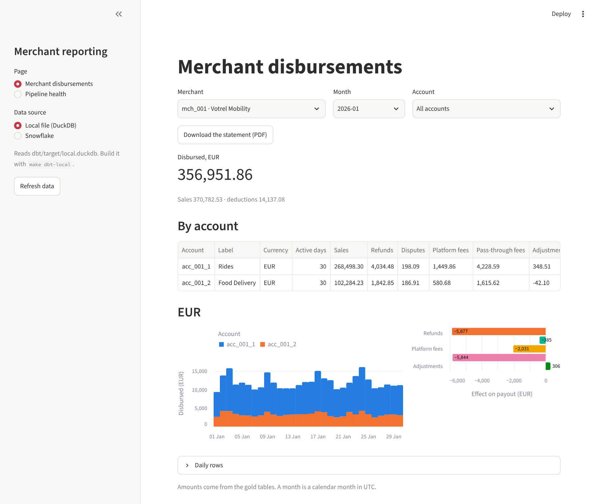
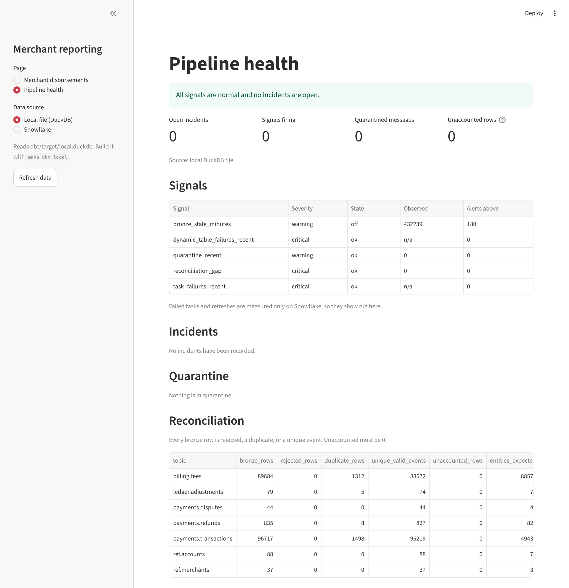
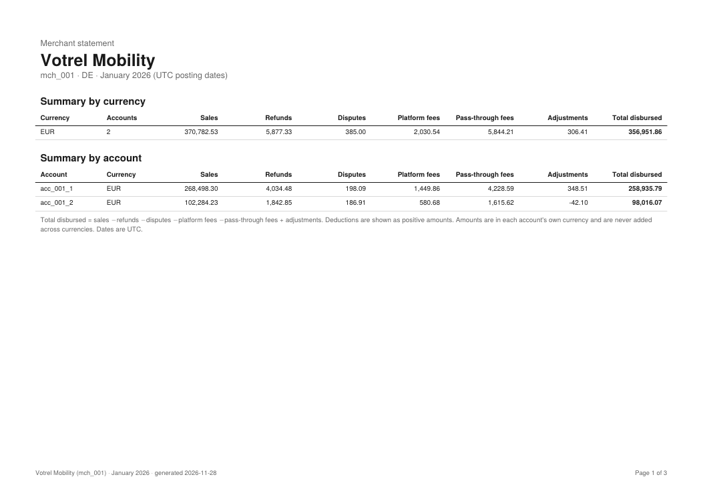

# Merchant Disbursement Pipeline

A Kafka to Snowflake pipeline that turns payment events into a daily disbursement report per merchant, account and currency, with PDF statements, a dashboard and alerting. Every number it prints can be traced to a ledger row, and every stage is checked against an answer key the pipeline never sees.



The diagram source is `docs/architecture.mmd`. Reading it top to bottom: a seeded generator publishes seven topics to Kafka; a file writer lands gzip NDJSON in a Snowflake stage; a task loads raw rows into **bronze**; streams with `MERGE` and dynamic tables build **silver** (bad rows go to **quarantine** with a reason); dbt builds **gold** (ledger, daily, monthly); a serverless alert writes incidents and sends email; statements and the dashboard read gold.

## What was proven, and how

Each phase ended at a gate that is an automated check, run on a real Snowflake account.

| Claim | Check | Result on Snowflake |
| --- | --- | --- |
| A replayed file loads exactly once | `make verify` | 187,684 messages loaded, replay adds none |
| Silver equals an independent local run | `make silver-verify` | 33 of 33 checks, all 15 dynamic tables refresh incrementally |
| Gold equals the oracle to the cent | `make gold`, `make gold-verify` | 21 of 21 dbt tests, 133,801 ledger rows, 2,199 daily rows, totals equal |
| No bad message is lost silently | `make chaos-drill` | 572 of 572 injected messages quarantined with the expected reason, then fully cleaned up |
| A failure raises an alert | `make alerts-drill` | one incident opened through the real alert, email sent, incident resolved |
| Printed statements equal gold | `make statements-verify-snowflake` | 30 statements, every check passes, grand totals equal gold in all five currencies |

## What it looks like

| | |
| --- | --- |
|  |  |
| Disbursements: totals per currency, by account, daily chart | Pipeline health: signals, incidents, quarantine, reconciliation |

A sample statement, built from the golden dataset: [`docs/samples/statement_mch_001_2026-01.pdf`](docs/samples/statement_mch_001_2026-01.pdf) (summary page, then one detail page per account).



## Try it

**Offline, free, about five minutes** (no Snowflake, no Kafka):

```bash
python -m venv .venv && source .venv/bin/activate
pip install -r requirements.txt -r requirements-dev.txt
make check          # lint, tests, branding check
make golden         # write the 30-day golden dataset
make dbt-oracle     # copy the answer key in as a dbt seed
make dbt-local      # silver on DuckDB, then gold with dbt (21 tests)
make statements-verify   # build every PDF and compare what is printed with gold
make dashboard      # Streamlit on the local file
make dbt-docs       # the dbt lineage graph
```

**On Snowflake**: follow `docs/SETUP_SNOWFLAKE.md` once, then `make integration` runs the whole pipeline and stops the meter at the end. `docs/DEMO.md` is a ten minute walk-through with cost-safe commands.

## Layout

| Folder | Purpose |
| --- | --- |
| `generator/` | Seeded event generator for seven topics, plus the oracle file |
| `file_writer/` | Consumes Kafka and writes staged files |
| `terraform/` | Account-level Snowflake objects: database, schemas, warehouses, monitors, roles |
| `sql/` | Versioned SQL for data objects: stage, bronze, load task, silver, quality, monitoring, grants (applied by `ops/deploy.py`) |
| `silver/` | Silver table specs, the SQL generator and the DuckDB test harness |
| `ops/` | Deploy, verify, drill and demo-mode helpers |
| `dbt/` | Gold models and the tests that compare them with the oracle |
| `statements/` | PDF statement builder and the verifier that reads the PDFs back |
| `dashboard/` | Streamlit app (local file or Snowflake) |
| `scripts/` | Branding check, key creation, the integration run |
| `tests/` | Python tests |

## Commands

| Command | What it does |
| --- | --- |
| `make check` | Lint, tests and branding check (free) |
| `make golden`, `make live` | Write the golden dataset, or publish it to Kafka |
| `make deploy` | Apply the versioned SQL, including grants |
| `make stage`, `make load` | Land files in the stage, load them into bronze now |
| `make demo-up`, `make demo-down` | Resume or suspend tasks, dynamic tables and the alert |
| `make silver-refresh`, `make silver-verify`, `make quality-verify` | Bring silver up to date and check it |
| `make gold`, `make gold-verify` | dbt build on Snowflake, independent comparison with the oracle |
| `make roles-verify` | Prove each role can do its job and nothing more |
| `make chaos-drill`, `make alerts-drill` | Inject failures and watch them be caught |
| `make statements-verify-snowflake`, `make dashboard-snowflake` | Reporting on the real gold tables |
| `make integration` | All of the above in order, ending with `make demo-down` |

## Cost and safety

Tasks, dynamic tables and the alert use credits while resumed. `make demo-down` suspends all of them and the integration script runs it on exit, even after a failure. Gold is built only on demand. Roles are narrow: the loader writes bronze, TRANSFORMER builds gold, REPORTER only reads gold and a few named views (`sql/70_grants.sql`, proven by `make roles-verify`). No credentials or email addresses are committed; a test fails if an address appears in the repository.

## Documents

`DECISIONS.md` records each choice and what the real Snowflake run taught. `docs/INTERVIEW_NOTES.md` is a short account of the design trade-offs. Per-phase guides: `docs/PHASE3_SILVER.md`, `docs/PHASE4_GOLD.md`, `docs/PHASE5_QUALITY.md`, `docs/PHASE6_MONITORING.md`, `docs/PHASE7_DASHBOARD.md`, `docs/PHASE8_PACKAGING.md`. The plan is in `docs/roadmap.md`.

## The generator

`python -m generator backfill` writes one NDJSON file per topic per day, an oracle file, and a manifest with hashes. `python -m generator live` publishes the same stream to Kafka. The same seed always gives the same bytes.

| Topic | Key | Events |
| --- | --- | --- |
| `ref.merchants` | `merchant_id` | upsert, delete |
| `ref.accounts` | `account_id` | upsert, delete |
| `payments.transactions` | `transaction_id` | authorized, captured, declined, voided |
| `payments.refunds` | `refund_id` | refund_issued |
| `payments.disputes` | `dispute_id` | dispute_opened, dispute_won, dispute_lost |
| `billing.fees` | `fee_id` | fee_assessed (platform or pass-through) |
| `ledger.adjustments` | `adjustment_id` | adjustment_posted |

Every message has the same envelope: `event_id`, `event_type`, `entity_id`, `event_time`, `emitted_at`, `schema_version`, `sequence`, and `op` on the reference topics. Money is integer minor units.

Delivery effects are switchable and never change the business truth: duplicate deliveries (about 1.5%), out-of-order arrival (about 2%), malformed poison messages (about 0.1%, six kinds), and one optional field added to transactions from day 15 (schema version 2).

`data/golden/oracle/daily_disbursement.csv` is the expected disbursement per merchant, account, currency and posting date, computed from the ledger entries and not from the delivered stream. `generator/reference.py` rebuilds it from the delivered messages alone (dedupe, reject malformed, post on event date), and a test proves the two agree. The warehouse gold table must match this file exactly.
